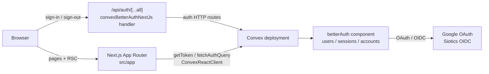

# Architecture — portal.siotics.org

## Purpose

Siotics Portal is a web application where users sign in with Google or the Siotics IdP and reach an authenticated home and account experience. Metadata and sign-in copy present it as the Siotics Portal. Google sign-in creates members; Siotics IdP sign-in creates admins.

## Tech stack

| Layer | Choice | Version / notes |
| --- | --- | --- |
| Package manager | pnpm | `10.18.3` (`packageManager` in `package.json`) |
| Framework | Next.js (App Router) | `16.3.8`; `output: "standalone"`; React Compiler enabled |
| UI runtime | React / React DOM | `19.2.8` |
| Backend | Convex | `^1.46.0` |
| Auth | better-auth + `@convex-dev/better-auth` | `~1.6.33` / `^0.12.5` |
| Styling | Tailwind CSS v4 | `@tailwindcss/postcss`; CSS entry `src/app/globals.css` |
| UI primitives | Base UI | `@base-ui/react` (Button, Menu, Dialog) + Tailwind zinc utilities |
| Icons | Phosphor | `@phosphor-icons/react` |
| Language | TypeScript | `^5`, path alias `@/*` → `./src/*` |
| Container | Docker multi-stage | Node `26.3.0-slim`; standalone Next server on port 3000 |

## High-level architecture

Auth runs inside Convex. Next.js serves the UI, gates portal routes on the server, and exposes a catch-all auth API route that registers Better Auth through `@convex-dev/better-auth/nextjs`.

## Repository layout

| Path | Owns |
| --- | --- |
| `src/app/` | App Router routes, root layout, globals, Convex client provider |
| `src/app/(portal)/` | Authenticated portal shell routes (`/`, `/account`) |
| `src/app/sign-in/` | Public sign-in page |
| `src/app/onboarding/` | Authenticated welcome page |
| `src/app/api/auth/[...all]/` | Better Auth HTTP handler re-export |
| `src/components/` | Auth screens, portal shell, session facts |
| `src/lib/` | Auth client/server helpers, portal user types, theme, utils |
| `convex/` | Convex app config, auth wiring, roles, empty app schema, HTTP router |
| `convex/betterAuth/` | Installed Better Auth Convex component (schema, adapter, generated API) |
| `convex/_generated/` | Convex codegen (API, data model, AI guidelines) |
| `public/` | Static assets |
| `docs/` | Project documentation |
| `Dockerfile` | Multi-stage standalone Next.js image build |
| `docker-compose.yaml` | Present; currently empty |
| `.env.example` | Documented env vars for Next and Convex auth |

## Request and data flow for authenticated portal pages

1. **Root layout** (`src/app/layout.tsx`) loads in parallel: the auth token via `getToken()` and the theme cookie. It wraps the tree in `ConvexClientProvider` with `initialToken`.
2. **Portal route group layout** (`src/app/(portal)/layout.tsx`) calls `requirePortalUser()`.
3. **`requirePortalUser`** uses `fetchAuthQuery(api.auth.getCurrentUser)`. Missing session redirects to `/sign-in`.
4. **`getCurrentUser`** (Convex query in `convex/auth.ts`) reads the authenticated user through `authComponent.safeGetAuthUser` and returns `{ name, email, role, image }`.
5. **Portal shell** receives that user and renders navigation (Home, Account), theme controls, and sign-out.
6. **Page bodies** (Home, Account) call `requirePortalUser()` again and render session facts.

Sign-in path:

1. `/sign-in` loads `fetchAuthQuery(api.auth.getCurrentUser)`; an existing user redirects to `/`.
2. Client `AuthMethods` calls `authClient.signIn.social({ provider: "google" })` or `authClient.signIn.oauth2({ providerId: "siotics" })`.
3. Requests go to `/api/auth/[...all]`, which is the Next.js Better Auth handler backed by Convex.
4. On user create, `databaseHooks` in `createAuthOptions` assign `role` from the provider: Google → `member`, Siotics IdP → `admin`.
5. Callback returns to `/` (or the configured `callbackURL`).

Sign-out uses `authClient.signOut()`, clears the dark theme class, then navigates to `/sign-in`.

## Boundaries

### Next.js

- App Router pages and layouts (RSC and client components).
- UI, theming (cookie + `localStorage`), and portal chrome.
- Server-side session gates (`requirePortalUser`, sign-in redirect-if-authenticated).
- Auth API proxy route and Convex React provider wiring.
- Standalone production build consumed by the Dockerfile.

### Convex

- App definition (`convex/convex.config.ts`) that mounts the Better Auth component.
- HTTP router (`convex/http.ts`) that registers Better Auth routes.
- Application query `auth.getCurrentUser`.
- Role and provider constants (`convex/roles.ts`) and env helpers (`convex/authEnv.ts`).
- Application schema (`convex/schema.ts`) — currently empty; product tables belong here when added.

### Better Auth component (`convex/betterAuth/`)

- Auth database tables (user, session, account, and related generated tables).
- Adapter API used by Better Auth.
- OAuth/OIDC configuration applied via `createAuthOptions` (Google social provider; optional Siotics generic OAuth/OIDC).
- JWT payload for Convex (`name`, `email`, `role`) through the Convex Better Auth plugin.
- Local schema generation / type inference (`betterAuth/auth.ts`, `generatedSchema.ts`).

Secrets and IdP credentials are Convex deployment env (synced from `.env.local` per `.env.example`). Next.js needs the public Convex URLs and matching site URL for the client and Next helper.

## Current maturity

- **App schema is empty.** Auth state lives in the Better Auth component schema; there are no product domain tables yet.
- **Portal surface is thin.** Authenticated Home and Account show session facts; onboarding is a minimal welcome page. No broader product features are implemented in-repo.
- **README is create-next-app bootstrap.** It still documents generic Next.js getting started and `npm`/`yarn` examples; project convention is pnpm.
- **`docker-compose.yaml` is empty.** The Dockerfile builds and runs the Next standalone server; compose does not define services yet.
- **`public/` still holds create-next-app placeholder SVGs.**
- **Auth wiring is the main completed vertical.** Google member and Siotics admin providers, role assignment, server gates, and Convex Better Auth integration are in place and driven by env configuration.
- **Version note.** Next.js 16 APIs and conventions may differ from older training data; follow `AGENTS.md` and `node_modules/next/dist/docs/` when changing framework code. Convex work should follow `convex/_generated/ai/guidelines.md`.
