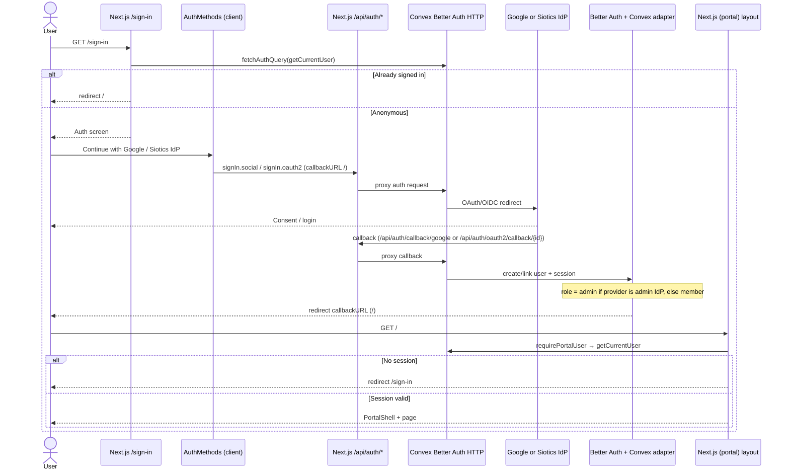

# Authentication and authorization

This document describes how portal.siotics.org authenticates users and assigns roles. Claims below come from the application source; file paths are cited for the important pieces.

## 1. Auth stack

The portal uses **Better Auth** hosted inside **Convex**, wired through **`@convex-dev/better-auth`**.

| Layer | Role |
| --- | --- |
| `better-auth` (`better-auth/minimal`) | Auth library: options, OAuth providers, user/session model, JWT plugin |
| `@convex-dev/better-auth` | Convex component, DB adapter, Next.js helpers, Convex JWT plugin |
| Convex HTTP router | Serves Better Auth HTTP endpoints from the Convex deployment |
| Next.js `/api/auth/[...all]` | Proxies auth HTTP to Convex via `convexBetterAuthNextJs` |
| Next.js React tree | `ConvexBetterAuthProvider` + Better Auth React client |

Auth **runs in Convex**. App secrets and provider credentials are Convex deployment env vars (kept in sync with `.env.local` via `pnpm exec convex env set`). See comments in [`convex/authOptions.ts`](../convex/authOptions.ts) and [`.env.example`](../.env.example).

Key wiring:

- [`convex/convex.config.ts`](../convex/convex.config.ts) registers the `betterAuth` component.
- [`convex/auth.ts`](../convex/auth.ts) creates `authComponent` with `createClient` and `createAuth(ctx)` with the component adapter.
- [`convex/betterAuth/auth.ts`](../convex/betterAuth/auth.ts) exports a static `betterAuth(createAuthOptions())` instance for schema generation and client type inference.
- [`convex/betterAuth/adapter.ts`](../convex/betterAuth/adapter.ts) exposes CRUD APIs via `createApi(schema, createAuthOptions)`.
- [`convex/auth.config.ts`](../convex/auth.config.ts) supplies Convex auth providers through `getAuthConfigProvider()`.
- [`convex/http.ts`](../convex/http.ts) calls `authComponent.registerRoutes(http, createAuth)`.

Better Auth stores users, sessions, accounts, verification tokens, and JWKS in the component schema ([`convex/betterAuth/generatedSchema.ts`](../convex/betterAuth/generatedSchema.ts), re-exported by [`convex/betterAuth/schema.ts`](../convex/betterAuth/schema.ts)). The app Convex schema ([`convex/schema.ts`](../convex/schema.ts)) is empty; auth tables live in the component.

## 2. Providers and methods

Only two sign-in methods appear in UI and options. There is **no** email OTP, magic link, or password sign-in configured in `createAuthOptions` or the sign-in UI.

### Google (social OAuth)

- Enabled when both `GOOGLE_CLIENT_ID` and `GOOGLE_CLIENT_SECRET` are set ([`convex/authEnv.ts`](../convex/authEnv.ts) `isGoogleConfigured()`).
- Configured as `socialProviders.google` in [`convex/authOptions.ts`](../convex/authOptions.ts).
- Client calls `authClient.signIn.social({ provider: "google", callbackURL: "/" })` in [`src/components/auth-methods.tsx`](../src/components/auth-methods.tsx).
- Provider id constant: `GOOGLE_PROVIDER_ID = "google"` ([`convex/roles.ts`](../convex/roles.ts)).
- Redirect URI (from [`.env.example`](../.env.example)): `{SITE_URL}/api/auth/callback/google`.
- First Google sign-in creates a user with **`role=member`**.

### Siotics IdP (generic OIDC / OAuth2)

- Enabled when `ADMIN_OIDC_CLIENT_ID`, `ADMIN_OIDC_CLIENT_SECRET`, and a discovery URL are set ([`isAdminConfigured()`](../convex/authEnv.ts)). Discovery comes from `ADMIN_OIDC_DISCOVERY_URL`, or is derived as `{ADMIN_OIDC_ISSUER}/.well-known/openid-configuration`.
- Registered through the Better Auth `genericOAuth` plugin in [`convex/authOptions.ts`](../convex/authOptions.ts), with PKCE enabled.
- Default provider id: `siotics` (`ADMIN_PROVIDER_ID` in [`convex/roles.ts`](../convex/roles.ts)); overridable via `ADMIN_OIDC_PROVIDER_ID` (must not be `"google"`).
- Default scopes: `openid`, `email`, `profile` (overridable via `ADMIN_OIDC_SCOPES`).
- Client calls `authClient.signIn.oauth2({ providerId: ADMIN_PROVIDER_ID, callbackURL: "/" })` in [`src/components/auth-methods.tsx`](../src/components/auth-methods.tsx).
- Redirect URI (from [`.env.example`](../.env.example)): `{SITE_URL}/api/auth/oauth2/callback/{ADMIN_OIDC_PROVIDER_ID}`.
- First Siotics IdP sign-in creates a user with **`role=admin`**.

### Role assignment on user create

[`convex/authOptions.ts`](../convex/authOptions.ts) sets `user.additionalFields.role` (default `member`, `input: false`) and a `databaseHooks.user.create.before` hook that sets `role` from `roleForProvider(providerIdFromContext(context))`.

[`roleForProvider`](../convex/authEnv.ts) returns `admin` when the provider id matches `adminProviderId()`; otherwise `member`.

The Convex JWT plugin `definePayload` also embeds `name`, `email`, and normalized `role` ([`convex/authOptions.ts`](../convex/authOptions.ts)).

## 3. Client vs server auth helpers

### Client — [`src/lib/auth-client.ts`](../src/lib/auth-client.ts)

```ts
createAuthClient({
  plugins: [
    inferAdditionalFields<typeof auth>(),
    genericOAuthClient(),
    convexClient(),
  ],
});
```

Used from client components for interactive auth:

- Sign-in buttons: `authClient.signIn.social` / `authClient.signIn.oauth2` ([`auth-methods.tsx`](../src/components/auth-methods.tsx)).
- Sign-out: `authClient.signOut()` then navigate to `/sign-in` ([`sign-out-button.tsx`](../src/components/sign-out-button.tsx)).

Wrapped into the React tree by [`ConvexClientProvider`](../src/app/ConvexClientProvider.tsx) via `ConvexBetterAuthProvider` with an optional `initialToken`.

### Server — [`src/lib/auth-server.ts`](../src/lib/auth-server.ts)

Created with `convexBetterAuthNextJs({ convexUrl, convexSiteUrl })` and exports:

| Export | Use in this app |
| --- | --- |
| `handler` | Next.js route handlers for `/api/auth/[...all]` |
| `getToken` | Root layout: seed `ConvexBetterAuthProvider` with `initialToken` |
| `fetchAuthQuery` | Server pages / `requirePortalUser` for `api.auth.getCurrentUser` |
| `preloadAuthQuery` | Exported; not referenced by app pages today |
| `isAuthenticated` | Exported; not referenced by app pages today |
| `fetchAuthMutation` / `fetchAuthAction` | Exported; not referenced by app pages today |

Defaults when env is missing: `NEXT_PUBLIC_CONVEX_URL` → `http://localhost:3001`, `NEXT_PUBLIC_CONVEX_SITE_URL` → `http://localhost:3000`.

### Convex query — [`getCurrentUser`](../convex/auth.ts)

`authComponent.safeGetAuthUser(ctx)` → returns `{ name, email, role, image }` or `null`. Role is normalized to `admin` or `member`.

## 4. Portal user model and roles

### Roles — [`convex/roles.ts`](../convex/roles.ts)

```ts
USER_ROLE = { member: "member", admin: "admin" }
GOOGLE_PROVIDER_ID = "google"
ADMIN_PROVIDER_ID = "siotics"
```

| Sign-in provider | Role on first user create |
| --- | --- |
| Google | `member` |
| Siotics IdP (`adminProviderId()`) | `admin` |

Account page copy matches this: “Google accounts join as members. Siotics IdP accounts join as admins.” ([`src/app/(portal)/account/page.tsx`](../src/app/(portal)/account/page.tsx)).

### Portal user — [`src/lib/portal-user.ts`](../src/lib/portal-user.ts)

```ts
type PortalUser = {
  name: string;
  email: string;
  role: UserRole;
  image: string | null;
};
```

Helpers: `roleLabel(role)` → `"Admin"` / `"Member"`; `initials(name)` for avatar fallbacks. The portal shell and session facts UI consume this shape.

There is no separate app-level permissions table. Authorization today is the `role` field on the Better Auth user (and in the JWT payload). Portal routes only require a signed-in user; they do not gate pages by admin vs member.

## 5. Route protection flow

There is **no** Next.js `middleware.ts`. Protection is server-side in layouts and pages via Convex auth queries.

### `/sign-in` — [`src/app/sign-in/page.tsx`](../src/app/sign-in/page.tsx)

1. `fetchAuthQuery(api.auth.getCurrentUser)`.
2. If a user exists → `redirect("/")`.
3. Otherwise render `AuthScreen` + `AuthMethods`.

### `/onboarding` — [`src/app/onboarding/page.tsx`](../src/app/onboarding/page.tsx)

1. `requirePortalUser()` (same gate as the portal).
2. Renders a welcome message with `user.name`.

OAuth `callbackURL` values and post-sign-in redirects target **`/`**, not `/onboarding`. Onboarding is an authenticated page; it is **not** currently an intermediate gate in the sign-in path.

### Portal group — [`src/app/(portal)/layout.tsx`](../src/app/(portal)/layout.tsx)

1. `requirePortalUser()` ([`src/lib/require-portal-user.ts`](../src/lib/require-portal-user.ts)).
2. If no user → `redirect("/sign-in")`.
3. Otherwise wrap children in `PortalShell` with the user.

Portal pages (`/`, `/account`) also call `requirePortalUser()` themselves.

### Root layout — [`src/app/layout.tsx`](../src/app/layout.tsx)

Loads `getToken()` and passes it to `ConvexClientProvider` so the client Convex session starts authenticated when a cookie/token already exists. This does not redirect; route gates do.

### Sign-out

Client `authClient.signOut()` → force light theme → `router.push("/sign-in")` → `router.refresh()` ([`sign-out-button.tsx`](../src/components/sign-out-button.tsx)).

## 6. HTTP routes and Convex auth wiring

```
Browser
  → Next.js GET/POST /api/auth/*
       ([src/app/api/auth/[...all]/route.ts](../src/app/api/auth/[...all]/route.ts)
        re-exports handler from auth-server)
  → convexBetterAuthNextJs handler
  → Convex site (Better Auth routes registered in [convex/http.ts](../convex/http.ts))
  → createAuth(ctx) + component adapter
```

Convex auth config ([`convex/auth.config.ts`](../convex/auth.config.ts)) uses `getAuthConfigProvider()` so Convex can validate JWTs issued by the Better Auth `convex` plugin.

The `before` hook on `/sign-in/oauth2` in [`createAuthOptions`](../convex/authOptions.ts) currently only early-returns unless the path and body provider id match the admin provider; it does not alter the request.

## 7. Environment variables

Names only. Do not commit secrets. Auth server values must exist on the **Convex deployment** (see [`.env.example`](../.env.example): sync with `pnpm exec convex env set --from-file .env.local`).

### Next.js / public

| Variable | Purpose |
| --- | --- |
| `CONVEX_DEPLOYMENT` | Written by `pnpm exec convex dev` |
| `NEXT_PUBLIC_CONVEX_URL` | Convex cloud URL for React client and server helpers |
| `NEXT_PUBLIC_CONVEX_SITE_URL` | Convex `.convex.site` host for auth HTTP |
| `NEXT_PUBLIC_SITE_URL` | Public app origin (must match `SITE_URL`; no trailing slash) |

### Convex / Better Auth (required for auth to work)

| Variable | Purpose |
| --- | --- |
| `SITE_URL` | Better Auth `baseURL` and `trustedOrigins` |
| `BETTER_AUTH_SECRET` | Better Auth secret (`openssl rand -base64 32`) |

### Google (optional; enables Google button path)

| Variable | Purpose |
| --- | --- |
| `GOOGLE_CLIENT_ID` | Google OAuth client id |
| `GOOGLE_CLIENT_SECRET` | Google OAuth client secret |

### Siotics IdP (optional; enables admin OIDC path)

| Variable | Purpose |
| --- | --- |
| `ADMIN_OIDC_CLIENT_ID` | OIDC client id |
| `ADMIN_OIDC_CLIENT_SECRET` | OIDC client secret |
| `ADMIN_OIDC_DISCOVERY_URL` | OpenID discovery document URL |
| `ADMIN_OIDC_ISSUER` | Issuer root; used to derive discovery if discovery URL unset |
| `ADMIN_OIDC_SCOPES` | Optional; default `openid,email,profile` |
| `ADMIN_OIDC_PROVIDER_ID` | Optional; default `siotics`; cannot be `google` |

The [`Dockerfile`](../Dockerfile) does not bake these secrets into the image; they are expected from the environment / Convex deployment at runtime.

## 8. Sign-in sequence



## File map

| Path | Responsibility |
| --- | --- |
| [`convex/auth.ts`](../convex/auth.ts) | Auth component client, `createAuth`, `getCurrentUser` |
| [`convex/auth.config.ts`](../convex/auth.config.ts) | Convex JWT provider config |
| [`convex/authEnv.ts`](../convex/authEnv.ts) | Provider env helpers, role-from-provider |
| [`convex/authOptions.ts`](../convex/authOptions.ts) | Better Auth options, plugins, hooks |
| [`convex/roles.ts`](../convex/roles.ts) | Role and provider id constants |
| [`convex/http.ts`](../convex/http.ts) | Register Better Auth HTTP routes |
| [`convex/betterAuth/*`](../convex/betterAuth/) | Component schema, static auth, adapter API |
| [`src/lib/auth-client.ts`](../src/lib/auth-client.ts) | Browser Better Auth client |
| [`src/lib/auth-server.ts`](../src/lib/auth-server.ts) | Next.js Convex Better Auth helpers |
| [`src/lib/portal-user.ts`](../src/lib/portal-user.ts) | Portal user type and display helpers |
| [`src/lib/require-portal-user.ts`](../src/lib/require-portal-user.ts) | Server gate → redirect `/sign-in` |
| [`src/app/api/auth/[...all]/route.ts`](../src/app/api/auth/[...all]/route.ts) | Auth HTTP proxy |
| [`src/components/auth-methods.tsx`](../src/components/auth-methods.tsx) | Google + Siotics sign-in buttons |
| [`.env.example`](../.env.example) | Env var names and redirect URI notes |
