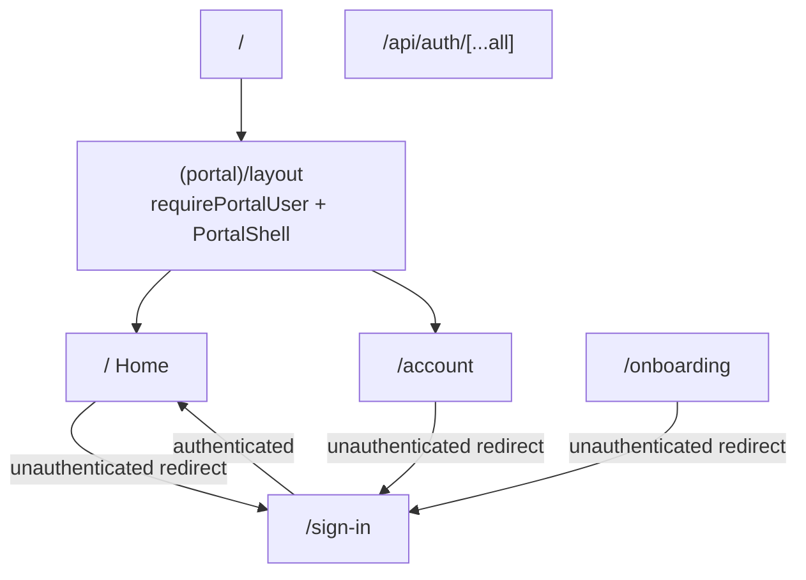

# Frontend

Next.js App Router UI for the Siotics Portal. Stack: Next.js 16, React 19, Tailwind CSS 4, `@base-ui/react`, Phosphor icons, Convex + Better Auth.

## App Router route map

| Path | Group | Auth | File | Role |
|------|-------|------|------|------|
| `/` | `(portal)` | Required (`requirePortalUser`) | `src/app/(portal)/page.tsx` | Home dashboard |
| `/account` | `(portal)` | Required | `src/app/(portal)/account/page.tsx` | Account / session facts |
| `/sign-in` | public | Redirects to `/` if already signed in | `src/app/sign-in/page.tsx` | OAuth entry |
| `/onboarding` | public (gated) | Required | `src/app/onboarding/page.tsx` | Stub welcome screen |
| `/api/auth/[...all]` | API | Better Auth handler | `src/app/api/auth/[...all]/route.ts` | Auth HTTP |

The `(portal)` segment is a route group: it does not appear in the URL. Portal pages share `src/app/(portal)/layout.tsx`, which wraps children in `PortalShell` after resolving the signed-in user.

Public pages (`/sign-in`, `/onboarding`) sit outside `(portal)` and do not receive the portal chrome. `/onboarding` still calls `requirePortalUser()` and redirects unauthenticated visitors to `/sign-in`.



## Layout hierarchy

```
RootLayout (src/app/layout.tsx)
├── fonts: Geist Sans / Geist Mono CSS variables
├── theme class from `portal-theme` cookie (`light` | `dark`)
├── ConvexClientProvider (initialToken)
└── children
    ├── (portal)/layout.tsx → requirePortalUser + PortalShell
    │   ├── / (home)
    │   └── /account
    ├── /sign-in
    └── /onboarding
```

### Root layout (`src/app/layout.tsx`)

Loads auth token and theme cookie in parallel, applies `dark` class when needed, wraps the tree in `ConvexClientProvider`.

### Portal layout (`src/app/(portal)/layout.tsx`)

Calls `requirePortalUser()`, then wraps page children in `PortalShell` with the resolved user.

### No nested layouts beyond this

Sign-in and onboarding use only the root layout.

## Component inventory

### Auth screens

| Component | Path | Kind | Notes |
|-----------|------|------|-------|
| `AuthScreen` | `src/components/auth-screen.tsx` | Client | Centered card shell; forces light theme on mount |
| `AuthMethods` | `src/components/auth-methods.tsx` | Client | Google social + Siotics IdP OAuth2 via `authClient` and `@base-ui/react/button` |
| `SignOutButton` / `SignOutMenuItem` | `src/components/sign-out-button.tsx` | Client | Clears dark class, signs out, navigates to `/sign-in`; menu item uses `@base-ui/react/menu` |

`/sign-in` composes `AuthScreen` + `AuthMethods`.

### Portal shell

| Component | Path | Kind | Notes |
|-----------|------|------|-------|
| `PortalShell` | `src/components/dashboard/portal-shell.tsx` | Client | Sticky header, collapsible desktop aside, mobile `Dialog` nav, theme toggle, user `Menu` |
| `SessionFacts` | `src/components/dashboard/session-facts.tsx` | Server-safe | Definition list of name / email / role |
| `UserAvatar` (internal) | inside `portal-shell.tsx` | Client | Next `Image` or initials fallback |
| `SidebarNavigation` (internal) | inside `portal-shell.tsx` | Client | Nav links for Home and Account |

Nav items:

- `/` — Home (`HouseIcon`)
- `/account` — Account (`UserIcon`)

Interactive chrome uses Base UI directly:

- `@base-ui/react/button` — header controls
- `@base-ui/react/menu` — user account menu
- `@base-ui/react/dialog` — mobile navigation drawer

There is no `src/components/ui/` kit and no `components.json`.

### Supporting lib

| Module | Path | Role |
|--------|------|------|
| `cn` | `src/lib/utils.ts` | Re-exports `cn` from the `cn` package |
| Theme constants | `src/lib/theme.ts` | `THEME_STORAGE_KEY`, `THEME_COOKIE_NAME`, `setThemeCookie`, `Theme` |
| `PortalUser` helpers | `src/lib/portal-user.ts` | Type, `roleLabel`, `initials` |
| `requirePortalUser` | `src/lib/require-portal-user.ts` | Server gate + redirect |
| Auth client / server | `src/lib/auth-client.ts`, `auth-server.ts` | Better Auth + Convex bridge |

## Theming

### Cookie + localStorage dual store (`src/lib/theme.ts`)

- Storage key and cookie name: `portal-theme`.
- Values: `"light"` | `"dark"`.
- Cookie: path `/`, max-age 365 days, `SameSite=Lax`, set from the client via `setThemeCookie`.
- Root layout reads the cookie on the server so the first paint includes the correct `dark` class.
- `PortalShell` mirrors preference in `localStorage` and syncs via `useSyncExternalStore` plus a custom `portal-preference-change` event.

### CSS (`src/app/globals.css`)

- Tailwind v4: `@import "tailwindcss"`.
- Dark variant: `@custom-variant dark (&:where(.dark, .dark *));`.
- Defined tokens:

```css
:root {
  --background: #ffffff;
  --foreground: #171717;
}
.dark {
  --background: #0a0a0a;
  --foreground: #ededed;
}
```

- `@theme inline` maps `--color-background`, `--color-foreground`, `--font-sans`, `--font-mono`.
- `.theme-transition` animates color-related properties for 300ms when the user toggles theme (skipped under `prefers-reduced-motion`).

Auth UI forces light mode in the browser (`AuthScreen` and sign-out clear `dark` / set `colorScheme: light`). Feature chrome uses explicit `zinc-*` Tailwind classes with `dark:` variants.

## Client / server boundaries

| Layer | Boundary |
|-------|----------|
| All `src/app/**/page.tsx` and layouts | Server Components (async where they fetch auth) |
| `ConvexClientProvider` | Client — Convex + Better Auth React provider |
| Auth UI (`AuthScreen`, `AuthMethods`, sign-out) | Client — browser OAuth / navigation |
| `PortalShell` | Client — pathname, media queries, theme/sidebar prefs, Dialog/Menu |
| `SessionFacts` | No `"use client"` — renders from server-passed props |
| `auth-client.ts` | Client module |
| `auth-server.ts` / `require-portal-user.ts` | Server-only usage |

Pattern: pages and layouts resolve auth on the server, then hand serializable `PortalUser` props into client shells for interactivity.

## UI patterns and conventions

1. **Route protection in layouts/pages**, not middleware: `requirePortalUser()` / `fetchAuthQuery(api.auth.getCurrentUser)` with `redirect`.
2. **Base UI primitives + Tailwind zinc utilities** for interactive chrome (button, menu, dialog).
3. **`cn(...)` for class merging**, usually via `@/lib/utils` (onboarding imports `cn` from `"cn"` directly).
4. **Phosphor icons** at fixed sizes (14–18), often with `aria-hidden` and `sr-only` labels on icon-only controls.
5. **Accessible chrome**: `aria-current="page"`, breadcrumb `nav`, dialog title/description in `sr-only`, theme toggle `aria-label`.
6. **Responsive sidebar**: desktop fixed aside (expanded 16rem / collapsed 3.5rem); mobile left `Dialog` under the sticky header; preference key `portal-sidebar`.
7. **Metadata**: page-level `title` values feed the root `%s - Siotics Portal` template.
8. **Image remote pattern**: `next.config.ts` allows `lh3.googleusercontent.com` for Google avatars; `output: "standalone"`; React Compiler enabled.
9. **Package manager**: `pnpm` (see `AGENTS.md` / `packageManager` in `package.json`).

## Gaps / stub pages

| Item | Evidence |
|------|----------|
| `/onboarding` is a stub | Renders only `Welcome {user.name}!` inside a bordered card; no onboarding flow, form, or redirect into the portal |
| Onboarding metadata title | `title: "Account"` on the onboarding page (copy-paste mismatch) |
| Home and Account overlap | Both render the same `SessionFacts` block; Home adds a signed-in greeting, Account adds role-policy copy |
| No App Router special files | No `loading`, `error`, or `not-found` UI |
| Onboarding outside portal shell | Authenticated users on `/onboarding` do not get `PortalShell` chrome |

## Dependencies (UI-relevant)

From `package.json`:

- `next@16.3.8`, `react@19.2.8`, `react-dom@19.2.8`
- `@base-ui/react`, `@phosphor-icons/react`, `cn`
- `convex`, `@convex-dev/better-auth`, `better-auth`
- Dev: `tailwindcss@4`, `@tailwindcss/postcss`, `babel-plugin-react-compiler`
